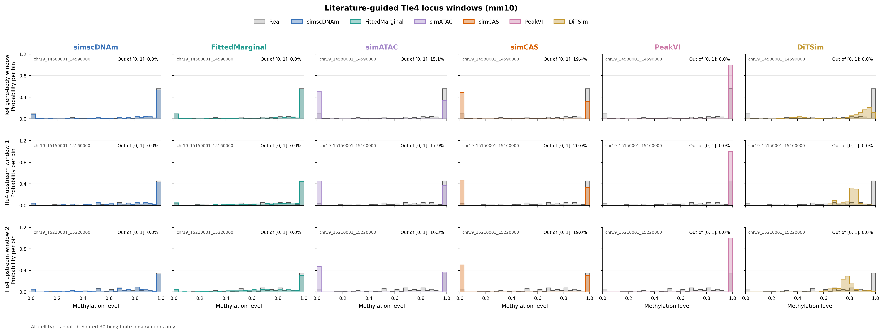
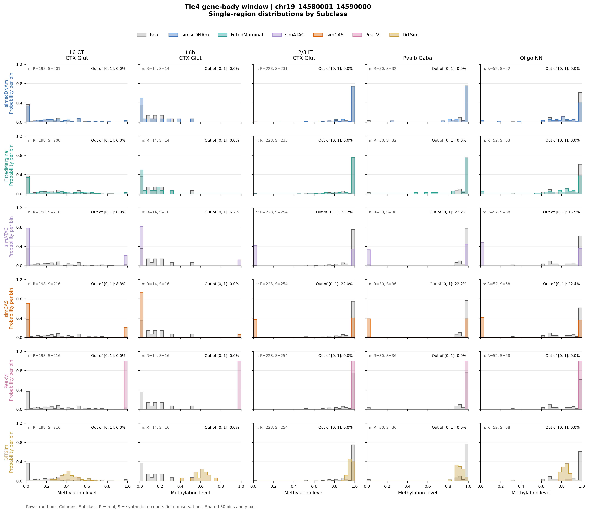
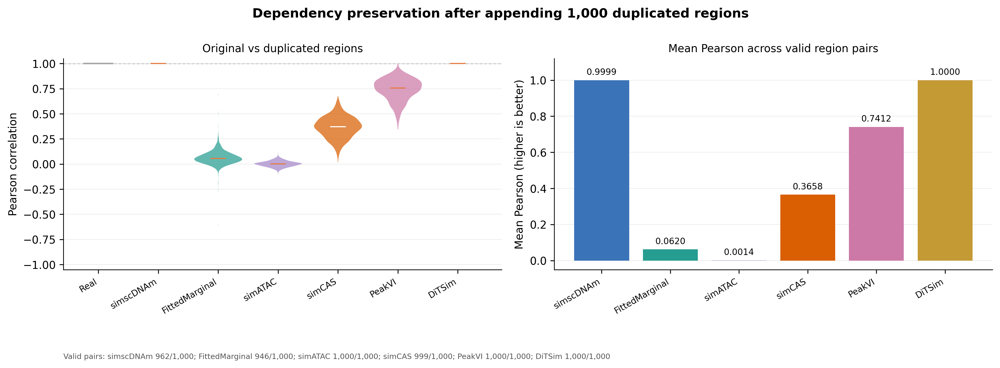
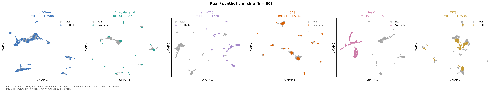
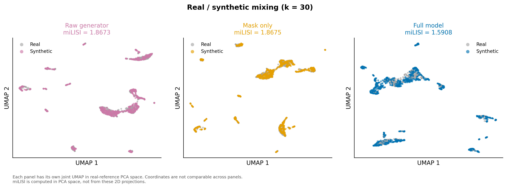
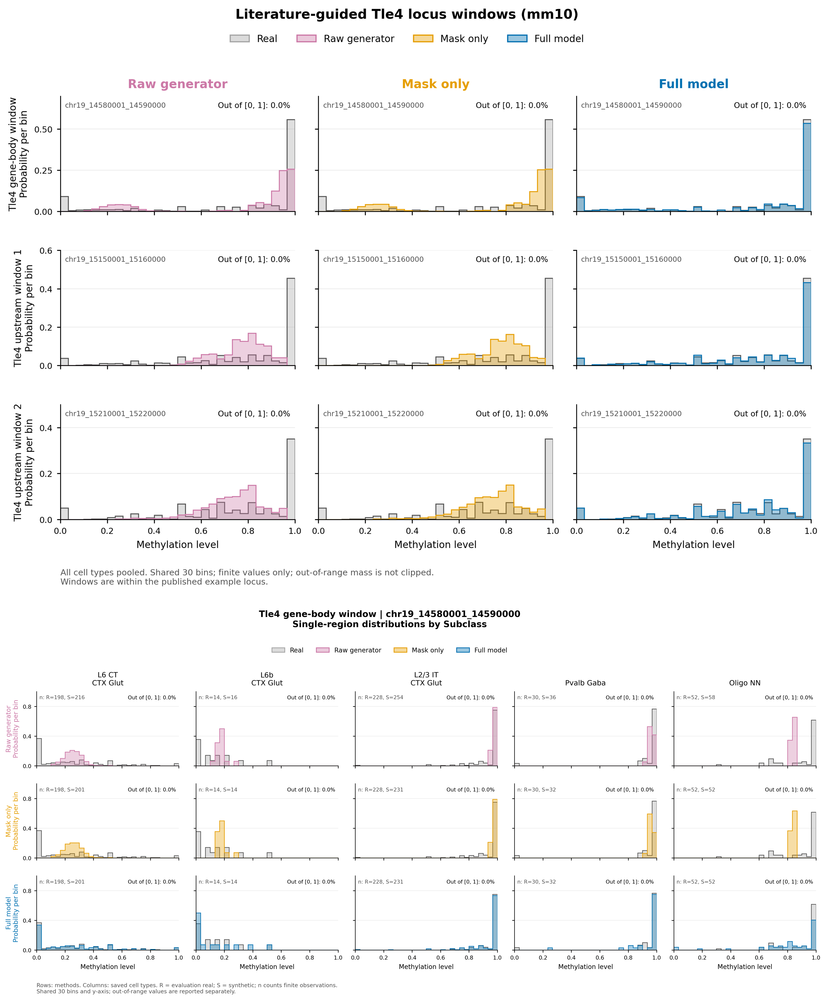

# 主实验与消融结果

**交付清单**：10 张主实验表、4 幅全量图、1 张消融表和 2 幅消融图。

每次评分更新后，用「更新结果README.ipynb」从 CSV 刷新本页。加粗值为该表最优；N/A 表示该指标无法定义。

过滤后主实验已评分 60/60 个方法与数据集组合，其中新增基线 20/20。

十组均按真实训练集的 Subclass 细胞数过滤。训练少于 10 个细胞的类别从本组训练和测试中同步移除。原训练／测试归属、区域轴和 1,000 对复制区域沿用原设定。[过滤记录](Subclass过滤汇总.json)

本页的 simscDNAm 主实验和消融使用 50 步 DDIM。复跑时在训练配置中设定 `DDIM_SAMPLING_STEPS=50`。

新基线使用真实训练集的逐区域中位数填补缺失，生成后裁剪到 [0,1]。各方法生成细胞数和逐 Subclass 配额与测试集相同。

**liu2023 全数据集**

| 方法 | A1 1-WD↓ | A1 MSE↓ | A1 Pearson↑ | A2 Pearson↑ | A3 miLISI↑ |
| :--- | ---: | ---: | ---: | ---: | ---: |
| simscDNAm | **0.03368** | 8.426e-06 | **0.92909** | 0.99991 | **1.59080** |
| FittedMarginal | 0.04308 | **8.179e-06** | 0.88798 | 0.06205 | 1.44924 |
| simATAC | 0.59495 | 6.087e-04 | 0.39236 | 0.00139 | 1.16202 |
| simCAS | 0.86245 | 9.037e-02 | 0.60661 | 0.36579 | 1.57623 |
| PeakVI | 0.15795 | 2.557e-02 | 0.13998 | 0.74117 | 1.00000 |
| DiTSim | 0.13975 | 9.558e-04 | 0.87821 | **0.99997** | 1.25382 |

**liu2023 GSE213221**

| 方法 | A1 1-WD↓ | A1 MSE↓ | A1 Pearson↑ | A2 Pearson↑ | A3 miLISI↑ |
| :--- | ---: | ---: | ---: | ---: | ---: |
| simscDNAm | **0.06191** | **3.190e-05** | **0.86273** | **0.99970** | **1.78016** |
| FittedMarginal | 0.07416 | 4.372e-05 | 0.78962 | 0.07519 | 1.66345 |
| simATAC | 0.60209 | 7.430e-04 | 0.25044 | 0.00391 | 1.31314 |
| simCAS | 1.21430 | 8.404e+00 | 0.42564 | 0.81010 | 1.69212 |
| PeakVI | 0.16247 | 2.717e-02 | 0.08753 | -0.00535 | 1.00000 |
| DiTSim | 0.16324 | 6.323e-04 | 0.79587 | 0.69194 | 1.09753 |

**liu2023 GSE215213**

| 方法 | A1 1-WD↓ | A1 MSE↓ | A1 Pearson↑ | A2 Pearson↑ | A3 miLISI↑ |
| :--- | ---: | ---: | ---: | ---: | ---: |
| simscDNAm | **0.06227** | 1.761e-05 | **0.85860** | **0.99938** | **1.77472** |
| FittedMarginal | 0.07279 | **9.690e-06** | 0.78036 | 0.06088 | 1.57491 |
| simATAC | 0.61050 | 6.864e-04 | 0.23793 | -0.00072 | 1.36525 |
| simCAS | 0.88989 | 1.828e-01 | 0.40692 | 0.61702 | 1.63821 |
| PeakVI | 0.15244 | 2.379e-02 | 0.09156 | -0.00504 | 1.00000 |
| DiTSim | 0.15162 | 7.630e-04 | 0.79504 | 0.78959 | 1.18634 |

**liu2023 GSE215342**

| 方法 | A1 1-WD↓ | A1 MSE↓ | A1 Pearson↑ | A2 Pearson↑ | A3 miLISI↑ |
| :--- | ---: | ---: | ---: | ---: | ---: |
| simscDNAm | **0.05539** | 1.513e-05 | **0.88229** | **0.99940** | **1.74937** |
| FittedMarginal | 0.06578 | **5.424e-06** | 0.81720 | 0.06732 | 1.57517 |
| simATAC | 0.61148 | 3.828e-04 | 0.20402 | -0.00015 | 1.30281 |
| simCAS | 1.19714 | 1.625e+01 | 0.49076 | 0.90483 | 1.60505 |
| PeakVI | 0.15742 | 2.500e-02 | 0.07942 | -0.00386 | 1.00000 |
| DiTSim | 0.15343 | 4.094e-04 | 0.81640 | 0.79466 | 1.09084 |

**liu2021 GSE130553**

| 方法 | A1 1-WD↓ | A1 MSE↓ | A1 Pearson↑ | A2 Pearson↑ | A3 miLISI↑ |
| :--- | ---: | ---: | ---: | ---: | ---: |
| simscDNAm | **0.06047** | 1.040e-05 | **0.86979** | **0.99949** | 1.54960 |
| FittedMarginal | 0.07215 | **4.462e-06** | 0.80000 | 0.04185 | **1.64480** |
| simATAC | 0.59502 | 6.152e-04 | 0.28950 | 0.00176 | 1.37303 |
| simCAS | 0.91481 | 1.797e-01 | 0.43524 | 0.30497 | 1.63332 |
| PeakVI | 0.17251 | 2.990e-02 | 0.11250 | -0.00548 | 1.00000 |
| DiTSim | 0.16252 | 3.429e-04 | 0.82246 | 0.73050 | 1.00265 |

**liu2021 GSE131354**

| 方法 | A1 1-WD↓ | A1 MSE↓ | A1 Pearson↑ | A2 Pearson↑ | A3 miLISI↑ |
| :--- | ---: | ---: | ---: | ---: | ---: |
| simscDNAm（探索性） | 0.12496 | 6.631e-05 | **0.76073** | **0.99460** | 1.45316 |
| FittedMarginal | **0.11960** | **3.036e-05** | 0.62695 | 0.08515 | 1.50276 |
| simATAC | 0.64994 | 2.855e-04 | 0.06521 | 0.01071 | **1.71869** |
| simCAS | 1.10732 | 8.485e-01 | 0.22639 | 0.20499 | 1.43354 |
| PeakVI | 0.16293 | 2.384e-02 | 0.06708 | -0.00136 | 1.00000 |
| DiTSim | 0.14002 | 2.979e-04 | 0.74735 | 0.08056 | 1.21540 |

该行来自内部 miLISI 最高的候选 frozen_beta_1e6。四个候选均未达到原内部重构与多样性验收门槛。

**liu2021 GSE131360**

| 方法 | A1 1-WD↓ | A1 MSE↓ | A1 Pearson↑ | A2 Pearson↑ | A3 miLISI↑ |
| :--- | ---: | ---: | ---: | ---: | ---: |
| simscDNAm | **0.08081** | 2.108e-05 | **0.82755** | **0.99853** | 1.74972 |
| FittedMarginal | 0.09111 | **1.247e-05** | 0.72779 | 0.09132 | **1.80685** |
| simATAC | 0.62718 | 3.902e-04 | 0.13357 | 0.00203 | 1.16044 |
| simCAS | 0.73723 | 1.199e-01 | 0.37044 | 0.17807 | 1.72279 |
| PeakVI | 0.15952 | 2.581e-02 | 0.07524 | -0.01291 | 1.00000 |
| DiTSim | 0.15223 | 5.130e-04 | 0.77524 | 0.67478 | 1.02821 |

**tian2023 GSE167119**

| 方法 | A1 1-WD↓ | A1 MSE↓ | A1 Pearson↑ | A2 Pearson↑ | A3 miLISI↑ |
| :--- | ---: | ---: | ---: | ---: | ---: |
| simscDNAm | **0.06855** | 4.037e-05 | **0.77618** | **0.99977** | 1.78209 |
| FittedMarginal | 0.08149 | **7.168e-06** | 0.67072 | 0.06872 | **1.80923** |
| simATAC | 0.64410 | 1.229e-03 | 0.26192 | 0.00606 | 1.45911 |
| simCAS | 1.25143 | 1.730e+00 | 0.30941 | 0.91128 | 1.56724 |
| PeakVI | 0.11101 | 1.311e-02 | 0.13792 | 0.01419 | 1.00000 |
| DiTSim | 0.13262 | 8.968e-04 | 0.72200 | 0.99252 | 1.00885 |

**tian2023 GSE167577**

| 方法 | A1 1-WD↓ | A1 MSE↓ | A1 Pearson↑ | A2 Pearson↑ | A3 miLISI↑ |
| :--- | ---: | ---: | ---: | ---: | ---: |
| simscDNAm | **0.07563** | 2.390e-05 | **0.77231** | 0.99888 | 1.80286 |
| FittedMarginal | 0.08483 | **8.046e-06** | 0.65139 | 0.08809 | **1.86721** |
| simATAC | 0.65145 | 9.954e-04 | 0.20281 | 0.00654 | 1.33010 |
| simCAS | 0.83825 | 1.554e-01 | 0.27576 | 0.26058 | 1.42131 |
| PeakVI | 0.10909 | 1.290e-02 | 0.10679 | 0.03398 | 1.00000 |
| DiTSim | 0.12105 | 1.182e-03 | 0.73203 | **0.99974** | 1.04087 |

**tian2023 GSE167978**

| 方法 | A1 1-WD↓ | A1 MSE↓ | A1 Pearson↑ | A2 Pearson↑ | A3 miLISI↑ |
| :--- | ---: | ---: | ---: | ---: | ---: |
| simscDNAm | **0.07346** | 4.529e-05 | **0.76706** | 0.99965 | 1.77074 |
| FittedMarginal | 0.08433 | **6.542e-06** | 0.65219 | 0.08115 | **1.84978** |
| simATAC | 0.64701 | 1.159e-03 | 0.22620 | 0.00013 | 1.31326 |
| simCAS | 1.18145 | 2.674e+00 | 0.29125 | 0.85158 | 1.36890 |
| PeakVI | 0.10969 | 1.294e-02 | 0.12275 | 0.06204 | 1.00000 |
| DiTSim | 0.11897 | 1.900e-03 | 0.72535 | **0.99982** | 1.03363 |

Liu2021 和 Tian2023 的六个子集使用逐元素核验后恢复的真实矩阵，并按本轮划分重新训练和评分。

边缘图采用 [Liu 等，Nature 2023 图 1d](https://www.nature.com/articles/s41586-023-06805-y/figures/1) 的 Tle4 展示范围。各窗口宽 10 kb，n 表示该区域的有限观测数。

**全量：多区域边缘分布**

**全量：单区域按 Subclass 的边缘分布**

**全量：复制区域 Pearson 小提琴图**

**全量：真实与合成数据联合 UMAP**

**Liu2023 全量后处理消融**

| 方法 | A1 1-WD↓ | A1 MSE↓ | A1 Pearson↑ | A2 Pearson↑ | A3 miLISI↑ |
| :--- | ---: | ---: | ---: | ---: | ---: |
| 同时去掉掩码和对齐 | 0.14218 | 5.001e-05 | 0.92621 | 0.93684 | 1.86734 |
| 去掉对齐，保留掩码 | 0.14166 | 1.270e-05 | **0.93738** | 0.96799 | **1.86748** |
| 完整simscDNAm | **0.03368** | **8.426e-06** | 0.92909 | **0.99991** | 1.59080 |

消融固定同一训练模型和采样种子，对比原始生成、仅训练缺失掩码和完整模型。UMAP 各面板独立拟合，miLISI 来自共享的训练参照 PCA 空间。

**消融：UMAP**

**消融：边缘对齐，上为全部类型合并，下为按 Subclass**

