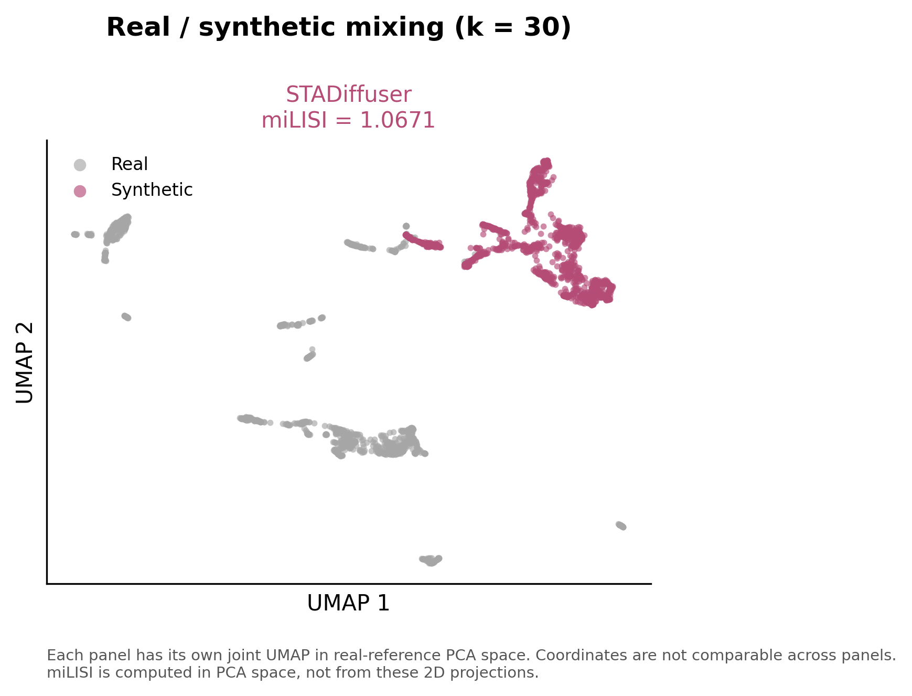

# Liu2023：STADiffuser 非空间 baseline 正式结果

2026年11月17日核查确认：AE 500轮、条件扩散1000轮、DDPM生成及统一评估均已完成。生成1190×273544矩阵，完整输出逐元素核验通过。其余四方法使用既有冻结的30近邻得分，本次仅新增训练与评估STADiffuser。

STADiffuser能很好地保留复制区域相关性，但本次边缘分布和细胞分布拟合较弱，五项指标均弱于完整simscDNAm。结论仅针对本轮Liu2023非空间配置。

## 五方法比较

| 方法 | A1 1-WD↓ | A1 MSE↓ | A1 Pearson↑ | A2 Pearson↑ | A3 miLISI↑ |
|---|---:|---:|---:|---:|---:|
| simscDNAm | 0.03594 | 1.368e-05 | 0.92122 | 0.99990 | 1.66503 |
| FittedMarginal | 0.04577 | 1.163e-05 | 0.87630 | 0.06875 | 1.53475 |
| simATAC | 0.59684 | 6.289e-04 | 0.38555 | 0.00044 | 1.17401 |
| simCAS | 0.79551 | 7.649e-02 | 0.61397 | 0.27713 | 1.53773 |
| STADiffuser | 0.16696 | 1.315e-03 | 0.86062 | 0.99642 | 1.06712 |

完整精度见[five_method_comparison.csv](five_method_comparison.csv)。MSE为各类型平均甲基化水平的偏差，不是逐元素重建误差。A2有效配对数依次为963、946、1000、999、1000；均值使用各方法的有效对。simATAC、simCAS仍保留原生计数／分数，存在数值域差异。

STADiffuser的1-WD约为simscDNAm的4.65倍；miLISI接近完全分离的1，35个真实类型中有24个的类型内miLISI中位数为1。联合UMAP中真实与合成细胞也明显分离；数值评分来自50维PCA空间。

## 与未做后处理的生成器比较

| 版本 | A1 1-WD↓ | A1 MSE↓ | A1 Pearson↑ | A2 Pearson↑ | A3 miLISI↑ |
|---|---:|---:|---:|---:|---:|
| CVAE_raw | 0.14291 | 3.627e-05 | 0.91800 | 0.94605 | 1.86886 |
| STADiffuser | 0.16696 | 1.315e-03 | 0.86062 | 0.99642 | 1.06712 |

CVAE_raw取自既有同划分、30近邻消融结果。相比未加mask或联合秩映射的CVAE_raw，STADiffuser仍是A2更高、其余四项更弱，因此差异不能全部归结为simscDNAm的后处理。完整精度见[generator_comparison.csv](generator_comparison.csv)。

## 诊断与解释

- 合成数据无缺失，真实留出原始区域缺失约20.15%。本次保留原生输出，没有为改善得分增加mask或对齐。
- 约0.0327%输出超出0–1，范围约为−0.1427至1.0373，未截断。1190个生成潜变量均不同，但这不能证明分布足够丰富。
- 同一50维PCA空间中，合成总方差约66.98，真实留出约256.84，比例26.1%，与分布收缩相符。具体原因仍需消融定位。
- 2000个自然区域的平均Spearman为真实0.02253、合成0.09382。高复制相关不能单独证明自然区域依赖结构也已匹配。
- 训练集全缺失区域7823个，按预定规则用有限区域中位数的中位数填补。AE末轮MSE约0.1191，扩散末轮MSE约0.03871；训练损失不替代生成质量指标。日志累计AE约4.92小时、扩散约0.39小时，不含其他阶段。

建议保留该深度生成baseline，并注明禁用空间信息和原生输出协议。本轮没有根据留出表现调参或增加后处理，不将结果解释为原方法在空间转录组上的能力排序。

## 核验与文件

[result_verification.json](result_verification.json)记录本次核验：500轮AE和1000轮扩散日志连续且损失有限；1190个留出ID、1000对复制映射与旧结果逐项一致；真实逐类型数量、权重、均值和缺失诊断一致；原四方法得分保持；新增A1类型加权、A2配对均值、A3类型中位数等权汇总复算一致。

入口：[baseline/STADiffuser/inference.ipynb](../../../baseline/STADiffuser/inference.ipynb)。上游固定提交为11be35ffce082d5d9cd4bfdcc8f8352fb4a58971，六个文件SHA256一致。保留官方网络、损失、32维潜空间和批内注意力，训练批大小256；自环图、空间条件None、Subclass生成、全目标共同解码。

服务器产物位于/home/sccasimp/data/xb/outputs/simscDNAm/STADiffuser_20261111/。本地已同步正式配置、日志、核验、指标和PNG图，未下载大型H5AD或权重。启动快照保留于历史归档；正式状态见[full/status.json](full/status.json)，评估记录见[evaluation/run_summary.json](evaluation/run_summary.json)。本次仅读取结果，未创建服务器终端或计算内核。

其他图：[区域边缘分布](evaluation/figures/A1_marginal_regions.png)、[按类型分布](evaluation/figures/A1_region_by_type.png)、[复制相关性](evaluation/figures/A2_duplicate_Pearson.png)。服务器自动汇总保存在[server_report.md](server_report.md)。
