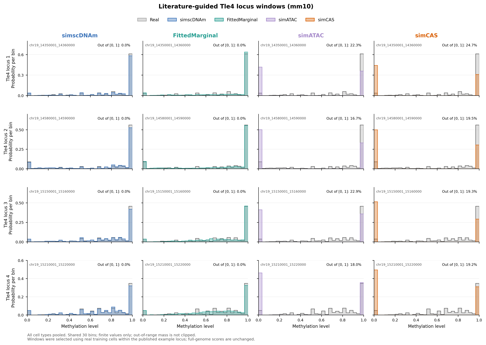
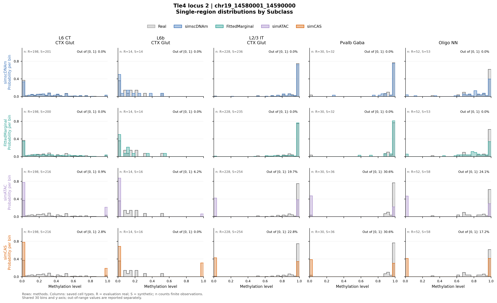
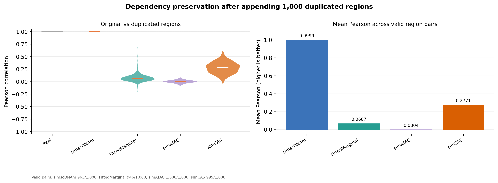
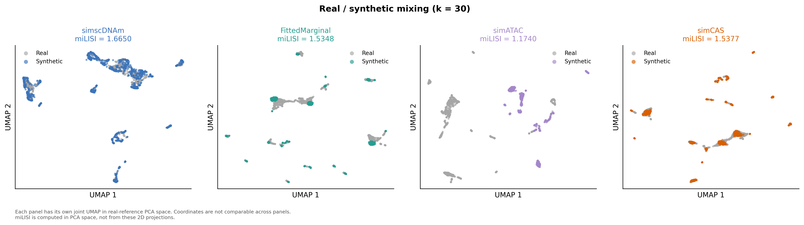
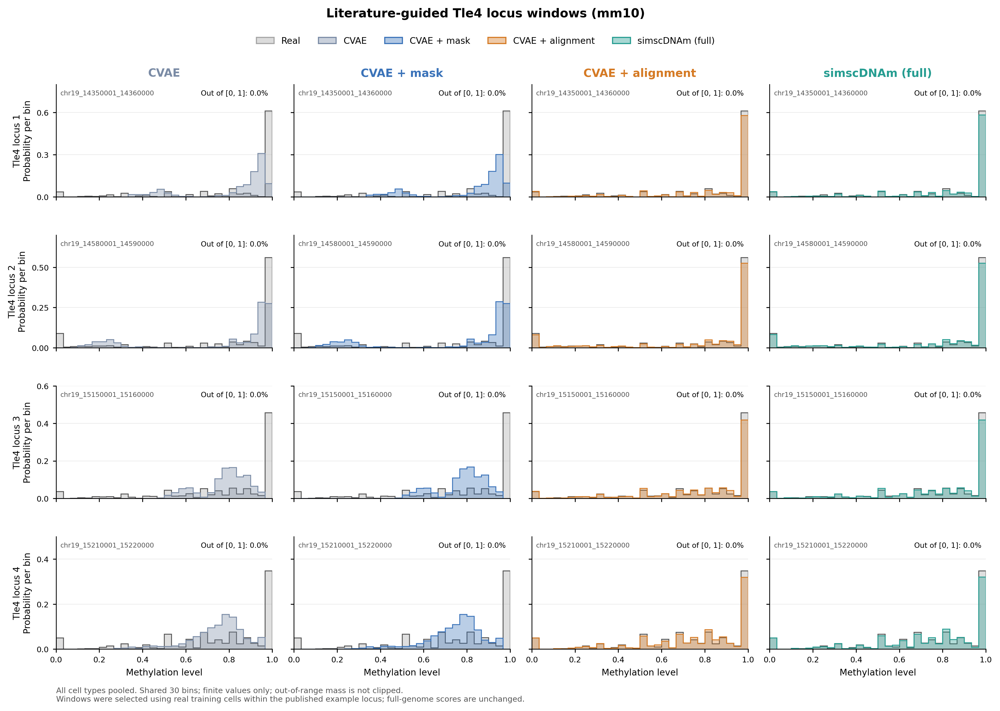
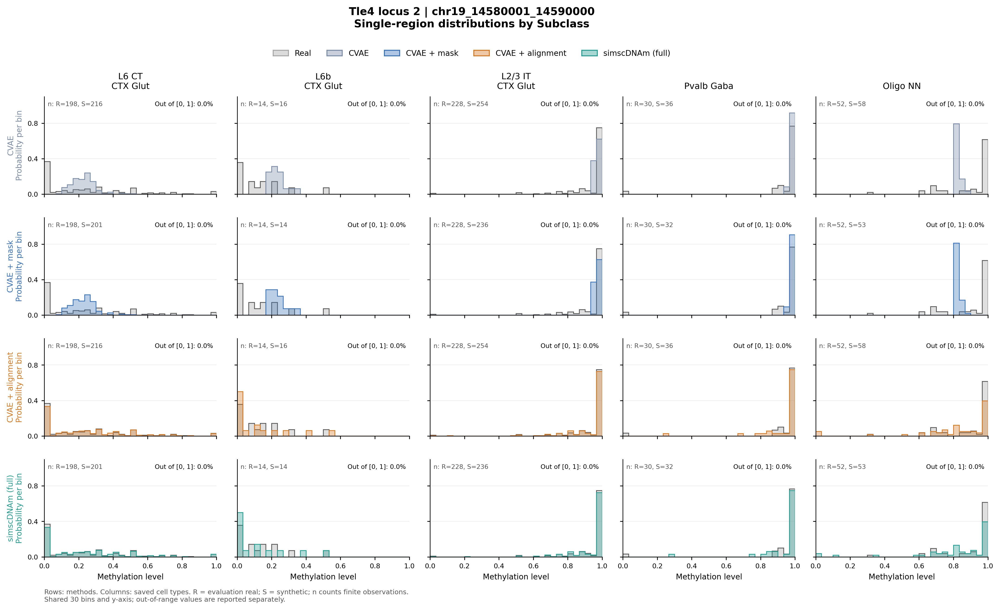
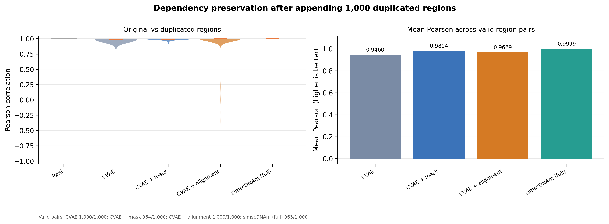
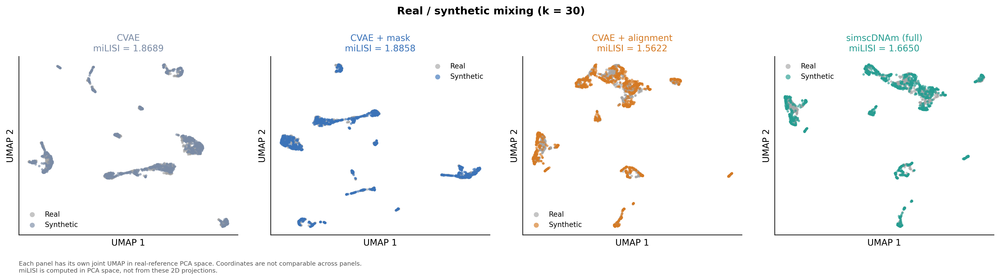

# 2026年11月17日：30-NN重新评分

本轮修正了服务器默认项目目录仍保留旧邻域设置、旧适配Notebook存在位置参数遗漏的问题。本地当前源码和服务器默认项目目录均通过递归检查，A3、内部miLISI和UMAP默认使用30近邻；当前重新评分入口全程仅计算30近邻。

全量四方法、九个GSE子集及全量四版本消融，共44行、220项指标，全部通过Jupyter重新计算。A1和A2直接读取原始H5AD重新计算，A3在已冻结且核验来源的训练参照ANOVA50000/PCA50空间重新计算；排除中心细胞，按真实Subclass的miLISI中位数等权平均。权重、合成矩阵和数据划分均未改变。全量及消融UMAP也重新计算，近邻数为30。

同口径的五项总分及A3逐类型结果均与此前已核验结果一致。历史执行记录保留原始参数与原始内容并归档，未将旧分数重标成新协议。现有checkpoint保留其原始选模历史，本轮未重新训练或重新选模。

加粗为同表最优。MSE是类型内细胞平均甲基化水平的偏差；simATAC和simCAS保留原生计数／分数，无截断或缩放。

**Liu2023全数据集**

训练4740个细胞，留出1190个细胞。

| 方法 | A1 1-WD↓ | A1 MSE↓ | A1 Pearson↑ | A2 Pearson↑ | A3 miLISI↑ |
|---|---:|---:|---:|---:|---:|
| simscDNAm | **0.03594** | 1.368e-05 | **0.92122** | **0.99990** | **1.66503** |
| FittedMarginal | 0.04577 | **1.163e-05** | 0.87630 | 0.06875 | 1.53475 |
| simATAC | 0.59684 | 6.289e-04 | 0.38555 | 0.00044 | 1.17401 |
| simCAS | 0.79551 | 7.649e-02 | 0.61397 | 0.27713 | 1.53773 |

**liu2023 · GSE213221**

训练883个细胞，留出222个细胞。

| 方法 | A1 1-WD↓ | A1 MSE↓ | A1 Pearson↑ | A2 Pearson↑ | A3 miLISI↑ |
|---|---:|---:|---:|---:|---:|
| simscDNAm | **0.06924** | 1.183e-04 | **0.83656** | **0.99933** | **1.82712** |
| FittedMarginal | 0.08220 | **6.708e-05** | 0.75328 | 0.11799 | 1.76076 |
| simATAC | 0.60976 | 8.412e-04 | 0.23472 | 0.00289 | 1.42738 |
| simCAS | 0.83001 | 4.569e-01 | 0.42881 | 0.26385 | 1.65821 |

**liu2023 · GSE215213**

训练1004个细胞，留出255个细胞。

| 方法 | A1 1-WD↓ | A1 MSE↓ | A1 Pearson↑ | A2 Pearson↑ | A3 miLISI↑ |
|---|---:|---:|---:|---:|---:|
| simscDNAm | **0.06848** | 6.883e-05 | **0.83370** | **0.99911** | **1.78112** |
| FittedMarginal | 0.08031 | **3.799e-05** | 0.74958 | 0.10281 | 1.60981 |
| simATAC | 0.61698 | 7.750e-04 | 0.22611 | 0.00187 | 1.40255 |
| simCAS | 0.78332 | 8.569e-02 | 0.44080 | 0.33317 | 1.53258 |

**liu2023 · GSE215342**

训练985个细胞，留出244个细胞。

| 方法 | A1 1-WD↓ | A1 MSE↓ | A1 Pearson↑ | A2 Pearson↑ | A3 miLISI↑ |
|---|---:|---:|---:|---:|---:|
| simscDNAm | **0.06018** | 7.511e-05 | **0.86386** | **0.99930** | **1.79413** |
| FittedMarginal | 0.07146 | **2.387e-05** | 0.79158 | 0.10829 | 1.70010 |
| simATAC | 0.61636 | 4.023e-04 | 0.19335 | 0.00627 | 1.35307 |
| simCAS | 0.88137 | 1.732e-01 | 0.41731 | 0.31814 | 1.60840 |

**liu2021 · GSE130553**

训练1059个细胞，留出266个细胞。

| 方法 | A1 1-WD↓ | A1 MSE↓ | A1 Pearson↑ | A2 Pearson↑ | A3 miLISI↑ |
|---|---:|---:|---:|---:|---:|
| simscDNAm | **0.07557** | 5.516e-05 | **0.80972** | **0.99871** | **1.82916** |
| FittedMarginal | 0.08991 | **2.937e-05** | 0.71738 | 0.11726 | 1.77619 |
| simATAC | 0.61468 | 6.929e-04 | 0.24619 | 0.00488 | 1.37425 |
| simCAS | 0.90763 | 5.655e+00 | 0.40271 | 0.65024 | 1.61352 |

**liu2021 · GSE131354**

训练218个细胞，留出65个细胞。

| 方法 | A1 1-WD↓ | A1 MSE↓ | A1 Pearson↑ | A2 Pearson↑ | A3 miLISI↑ |
|---|---:|---:|---:|---:|---:|
| simscDNAm | **0.13301** | 8.706e-04 | **0.64870** | **0.97844** | **1.92762** |
| FittedMarginal | 0.14354 | **1.151e-04** | 0.49270 | 0.39256 | 1.36934 |
| simATAC | 0.67926 | 4.525e-04 | 0.03803 | 0.00594 | 1.16995 |
| simCAS | 0.81032 | 4.076e-01 | 0.17438 | 0.14577 | 1.33464 |

**liu2021 · GSE131360**

训练947个细胞，留出248个细胞。

| 方法 | A1 1-WD↓ | A1 MSE↓ | A1 Pearson↑ | A2 Pearson↑ | A3 miLISI↑ |
|---|---:|---:|---:|---:|---:|
| simscDNAm | **0.09090** | 1.031e-04 | **0.77795** | **0.99773** | 1.81320 |
| FittedMarginal | 0.10363 | **2.237e-05** | 0.66024 | 0.17748 | **1.85018** |
| simATAC | 0.64209 | 4.929e-04 | 0.11112 | -2.916e-06 | 1.24092 |
| simCAS | 0.86791 | 6.026e-01 | 0.29445 | 0.31736 | 1.77582 |

**tian2023 · GSE167119**

训练1819个细胞，留出462个细胞。

| 方法 | A1 1-WD↓ | A1 MSE↓ | A1 Pearson↑ | A2 Pearson↑ | A3 miLISI↑ |
|---|---:|---:|---:|---:|---:|
| simscDNAm | **0.07656** | 2.433e-04 | **0.73580** | **0.99899** | 1.73883 |
| FittedMarginal | 0.08813 | **1.486e-05** | 0.62999 | 0.11282 | **1.78826** |
| simATAC | 0.65247 | 1.310e-03 | 0.23903 | 0.00504 | 1.29461 |
| simCAS | 0.88065 | 3.935e-01 | 0.27513 | 0.29888 | 1.35830 |

**tian2023 · GSE167577**

训练2013个细胞，留出505个细胞。

| 方法 | A1 1-WD↓ | A1 MSE↓ | A1 Pearson↑ | A2 Pearson↑ | A3 miLISI↑ |
|---|---:|---:|---:|---:|---:|
| simscDNAm | **0.07760** | 7.632e-05 | **0.75571** | **0.99918** | 1.81934 |
| FittedMarginal | 0.08731 | **8.811e-06** | 0.63335 | 0.11199 | **1.82823** |
| simATAC | 0.65596 | 9.168e-04 | 0.19449 | 0.00358 | 1.30359 |
| simCAS | 1.29928 | 1.131e+01 | 0.25389 | 0.87143 | 1.40497 |

**tian2023 · GSE167978**

训练2312个细胞，留出580个细胞。

| 方法 | A1 1-WD↓ | A1 MSE↓ | A1 Pearson↑ | A2 Pearson↑ | A3 miLISI↑ |
|---|---:|---:|---:|---:|---:|
| simscDNAm | **0.07594** | 6.427e-05 | **0.74996** | **0.99924** | 1.74824 |
| FittedMarginal | 0.08723 | **6.052e-06** | 0.63075 | 0.10003 | **1.83049** |
| simATAC | 0.65220 | 1.134e-03 | 0.21604 | 0.00370 | 1.30486 |
| simCAS | 1.01501 | 6.515e-01 | 0.26426 | 0.77696 | 1.32002 |

**全量消融**

训练4740个细胞，留出1190个细胞。

| 方法 | A1 1-WD↓ | A1 MSE↓ | A1 Pearson↑ | A2 Pearson↑ | A3 miLISI↑ |
|---|---:|---:|---:|---:|---:|
| CVAE（两项均去除） | 0.14291 | 3.627e-05 | 0.91800 | 0.94605 | 1.86886 |
| 去掉对齐，保留mask | 0.14240 | 1.413e-05 | **0.92928** | 0.98044 | **1.88583** |
| 去掉mask，保留对齐 | 0.03680 | 4.022e-05 | 0.90952 | 0.96692 | 1.56221 |
| 完整simscDNAm | **0.03594** | **1.368e-05** | 0.92122 | **0.99990** | 1.66503 |

十组四方法比较中，simscDNAm的1-WD、A1 Pearson、A2 Pearson均在10组最优，miLISI在6组最优；FittedMarginal在其余4组miLISI以及全部10组MSE上最优。全量消融仍显示对齐改善边缘分布和复制相关性，同时降低miLISI。

A2按各版本实际有效配对计算，缺失或恒定列不能计算的配对不会补分。高复制相关来自联合后处理约束。小类型沿用原对齐规则，未逐子集调参。当前划分曾多轮查看，不属于新的独立外部盲测。邻域尺度改变本身不代表生成数据质量改善。

**全量四方法：固定区域边缘分布**

**全量四方法：按Subclass的边缘分布**

**全量四方法：复制区域Pearson**

**全量四方法：30近邻联合UMAP**

**全量消融：固定区域边缘分布**

**全量消融：按Subclass的边缘分布**

**全量消融：复制区域Pearson**

**全量消融：30近邻联合UMAP**

各UMAP面板分别拟合，面板间坐标不可直接比较。A1/A2图沿用相同矩阵的既有绘图数据；五项分数均为本轮实际重算。精确CSV、逐类型核验、源码同步记录、PNG及PDF随报告保存。
