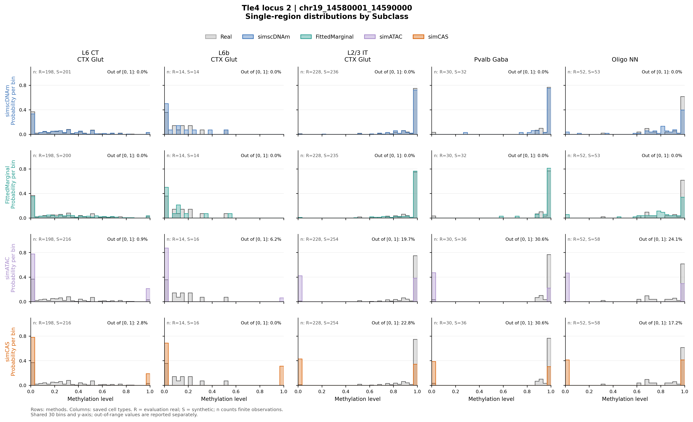
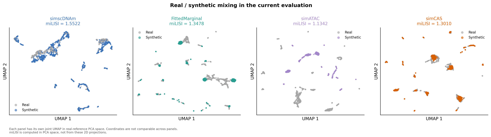

# Liu2023全量数据：simscDNAm与三个baseline

主模型为 **CVAE＋同类型训练mask＋联合秩映射**，正式名称为simscDNAm。训练4740个细胞，内部fit4257、内部验证483；固定外层留出1190个细胞。全部方法使用同一真实Subclass、同一4740训练参照和同一完整区域轴。

## 正式得分

| 方法 | A1 1-WD↓ | A1 MSE↓ | A1 Pearson↑ | A2 Pearson↑ | A3 miLISI↑ |
|---|---:|---:|---:|---:|---:|
| simscDNAm | 0.035940 | 1.368040e-05 | 0.921216 | 0.999896 | 1.552200 |
| FittedMarginal | 0.045771 | 1.163417e-05 | 0.876301 | 0.068749 | 1.347828 |
| simATAC | 0.596839 | 6.289328e-04 | 0.385547 | 0.000442 | 1.134233 |
| simCAS | 0.795515 | 7.648709e-02 | 0.613972 | 0.277128 | 1.301003 |

A2有效配对数：simscDNAm 963/1000、FittedMarginal 946/1000、simATAC 1000/1000、simCAS 999/1000。恒定列或共同观测不足的对记为缺失，未按配对表重写合成列。A1/A3仅使用272544个自然区域，排除最后1000个复制区域。

三个baseline复用已核验的`baseline_20261030`全维生成产物，**本轮重新运行全部正式评估，没有重新拟合baseline**。simscDNAm复用11月7日CVAE checkpoint和mask，正式入口复现联合映射，固定因子上限32、投影强度1。完整矩阵与已确认版本最大绝对差为0，checkpoint逐字节一致；五项得分均与对应既有结果复算一致。

## 四类图表

灰色为真实留出，颜色为各合成方法。固定使用训练数据选出的4个Tle4区域，没有按本轮合成结果挑选窗口。A1直方图共享0–1范围和30个分箱，超出范围的概率单独标注；该展示范围不改变正式指标。所有图同时提供同名PDF。

每幅UMAP由该方法与真实值分别联合拟合，跨面板坐标不能直接比较。图上miLISI来自共同训练参照的PCA空间，不从二维UMAP计算。

## 解释边界

相对同一checkpoint的未对齐CVAE＋mask，对齐使1-WD从0.142403降至0.035940，复制Pearson从0.980443升至0.999896；但A1区域均值Pearson从0.929280降至0.921216，miLISI从1.694681降至1.552200。高复制相关由后处理联合约束取得，不能作为原CVAE自主学会相关结构的证据，也不能把本次结果称为所有质量维度全面提升。

simATAC、simCAS沿用当前协议的比例输入，并保留官方原生计数／分数输出；数值域可能超出0–1，见[input_diagnostics.csv](input_diagnostics.csv)。该比较不等同于它们在各自原始任务上的能力排序。

同一外层划分已经在设计中多轮查看，属于探索性验证；本轮没有新增独立供体或外部研究测试，也没有把其他研究的旧版本结果改名为当前模型结果。

## 复现与证据

- [config.yaml](config.yaml)：本次实际服务器配置；迁移时修改路径。根目录的`evaluate/config.yaml`则与从头训练的默认输出目录配套。
- [A1_A2_A3_summary.csv](A1_A2_A3_summary.csv)：全部精确得分；其余逐类型、逐复制对和绘图分箱表同目录保存。
- [A3_joint_coordinates.csv](A3_joint_coordinates.csv)：图中实际坐标；[run_summary.json](run_summary.json)记录依赖版本、输入和评估参数。
- [matrix_verification.json](matrix_verification.json)、[verification.json](verification.json)：整合前后矩阵、checkpoint及四方法得分核验。
- [model_completed.json](model_completed.json)、[alignment_summary.json](alignment_summary.json)：正式生成与映射记录。
- [test_report.json](test_report.json)：58项测试通过及审阅范围；测试代码在仓库中。
- [final_audit.json](final_audit.json)：服务器执行与本地源码一致性；[environment.json](environment.json)记录实际Python及数值依赖版本。

正式入口为[主模型notebook](../../simscDNAm/train.ipynb)和[统一评估notebook](../../evaluate/A1A2A3.ipynb)。拟合的联合因子、经验分位数、checkpoint、大型H5AD和完整运行缓存保留在服务器输出目录，未提交到GitHub。

服务器控制Jupyter内核已关闭，记录见[cleanup.json](cleanup.json)；未打开服务器终端或关闭其他会话。
