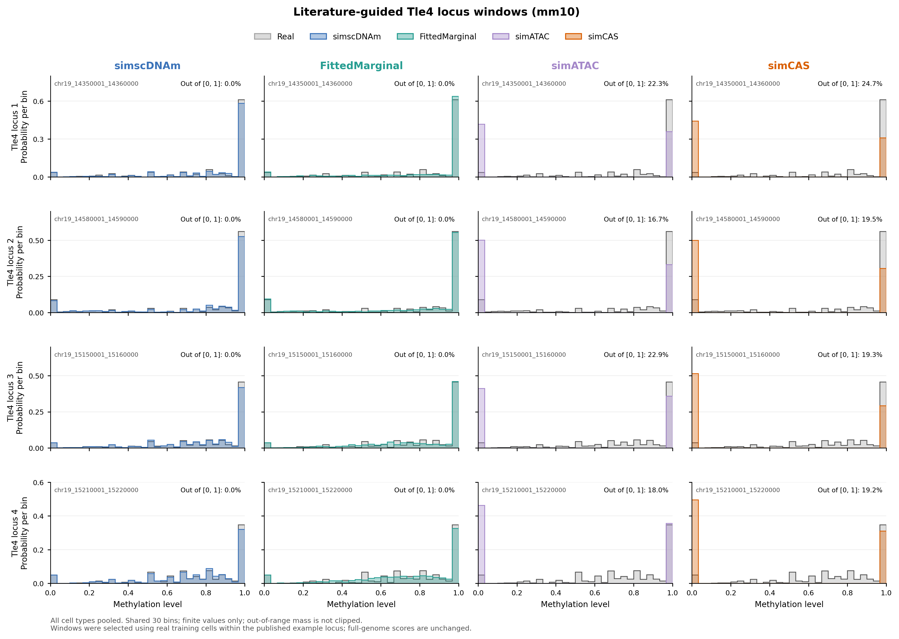
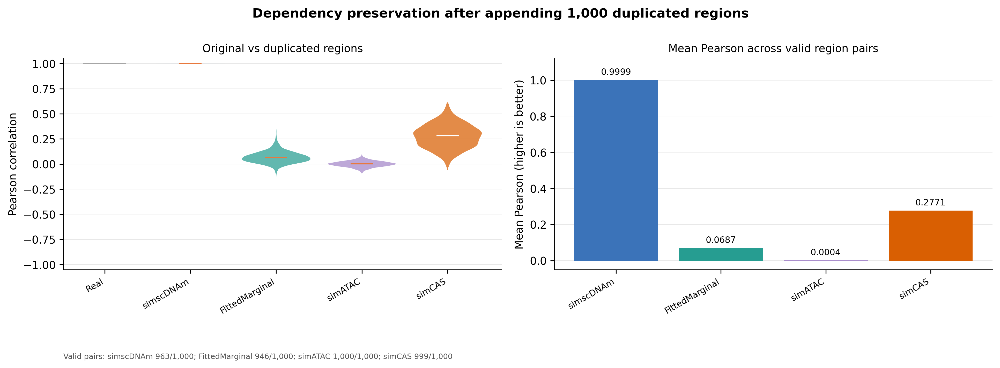

# Liu2023全量数据：30近邻正式结果

当前A3协议为30近邻。原11月7日权重、同类型真实mask及固定32/1联合秩映射保持不变；训练4740个细胞，内部fit4257、验证483，外层留出1190。现有checkpoint保留原10近邻内部选模历史，本次未重训或重新选模；未来训练默认30近邻。

**Liu2023全数据集**

训练4740个细胞，留出1190个细胞。

| 版本 | A1 1-WD↓ | A1 MSE↓ | A1 Pearson↑ | A2 Pearson↑ | A3 miLISI↑ |
|---|---:|---:|---:|---:|---:|
| simscDNAm | **0.03594** | 1.368e-05 | **0.92122** | **0.99990** | **1.66503** |
| FittedMarginal | 0.04577 | **1.163e-05** | 0.87630 | 0.06875 | 1.53475 |
| simATAC | 0.59684 | 6.289e-04 | 0.38555 | 0.00044 | 1.17401 |
| simCAS | 0.79551 | 7.649e-02 | 0.61397 | 0.27713 | 1.53773 |

A1/A2逐值复用原已核验结果；A3复用冻结的训练参照ANOVA50000/PCA50坐标重新计算，原10近邻总分及类型明细回归通过。全量四方法和九子集共40行结果，以及四版本消融，见[完整报告](../knn30_20261111/README.md)。

相对未对齐CVAE＋mask，对齐后1-WD由0.142403降至0.035940，复制Pearson由0.980443升至0.999896；A1 Pearson由0.929280降至0.921216，30近邻miLISI由1.885830降至1.665028。完整模型未在所有质量指标上提升。

固定区域、缺失配对及simATAC/simCAS数值域解释沿用原协议。原训练／矩阵回放核验文件保留原始日期和参数；当前评估参数与核验以本页config.yaml、run_summary.json及verification.json为准。

各面板分别拟合联合UMAP，坐标不能跨面板比较；图中miLISI从PCA空间计算。所有图同时提供PDF。
